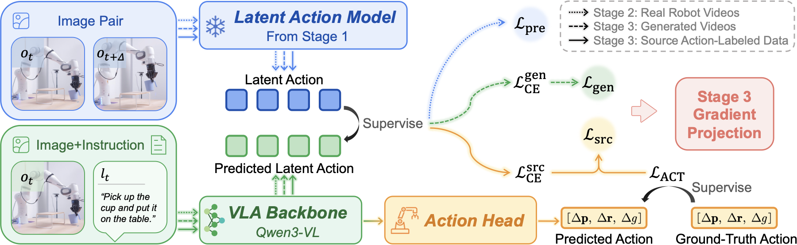

<h1 align="center">FreeAct: Demonstration-Free Robot Adaptation<br>via Action-Grounded Generated Videos</h1>

<p align="center"><strong>NeurIPS 2026</strong></p>

<p align="center">
  Zhe-Han Mo · Jia-Ning Li · Jiaxi Song · Meng-Hao Guo · Shi-Min Hu<sup>*</sup><br>
  BNRist, Department of Computer Science and Technology, Tsinghua University<br>
  <sub><sup>*</sup>Corresponding author</sub>
</p>

<p align="center">
  <a href="https://freeact.pages.dev/FreeAct.pdf"><b>Paper PDF</b></a> &nbsp;·&nbsp;
  <a href="https://freeact.pages.dev/"><b>Project Page</b></a> &nbsp;·&nbsp;
  <a href="https://huggingface.co/Mo-ZheHan/FreeAct"><b>Models</b></a> &nbsp;·&nbsp;
  <a href="https://huggingface.co/datasets/Mo-ZheHan/FreeAct-Data"><b>Data</b></a>
</p>

<p align="center"></p>

## Overview

FreeAct adapts a pretrained vision-language-action (VLA) policy to a new environment without target-domain expert demonstrations. A physically grounded latent action model (LAM) pseudo-labels generated videos of the target tasks with latent action tokens, and the policy is trained on these tokens together with source-domain action supervision. In simulation, this raises success on five target tasks from 1.6% to 56.8%, and to 73.6% after MLLM-guided self-evolution.

This repository is the PyTorch implementation of all three training stages, self-evolution, closed-loop evaluation and the latent action analysis (RQ1). A [Jittor implementation](https://github.com/Mo-ZheHan/FreeAct-Jittor) of inference, evaluation and analysis is also available.

## Installation

Tested on Linux with Python 3.11, CUDA 12.8 and NVIDIA RTX 4090 GPUs. Dependencies are pinned in `uv.lock` and installed with [uv](https://docs.astral.sh/uv/getting-started/installation/):

```bash
git clone https://github.com/Mo-ZheHan/FreeAct.git
cd FreeAct
uv sync --frozen   # add --extra train (stages 2–3) and/or --extra judge (MLLM judge) to this command
source .venv/bin/activate
```

## Quick start

```bash
hf download Mo-ZheHan/FreeAct --include 'stage3/*' --local-dir checkpoints/FreeAct
bash scripts/eval.sh checkpoints/FreeAct/stage3
```

This runs 50 rollouts per task on Tasks A–E on all visible GPUs (about 2 hours on two RTX 4090s) and writes the success rates to `outputs/eval/<run>/results.json`. Append `--n_episodes 10` for a quick check.

## Model zoo

Checkpoints are hosted at [Mo-ZheHan/FreeAct](https://huggingface.co/Mo-ZheHan/FreeAct).

| Checkpoint | Description | Tasks | Success (%) |
|---|---|---|---:|
| [`lam/`](https://huggingface.co/Mo-ZheHan/FreeAct/tree/main/lam) | Stage-1 latent action model | – | – |
| [`stage2/`](https://huggingface.co/Mo-ZheHan/FreeAct/tree/main/stage2) | Stage-2 pretrained VLA | – | – |
| [`stage3/`](https://huggingface.co/Mo-ZheHan/FreeAct/tree/main/stage3) | Adapted policy | A–E / B (camera shift) / C (ketchup bottle) | 56.8 / 74 / 60 |
| [`self_evolve/`](https://huggingface.co/Mo-ZheHan/FreeAct/tree/main/self_evolve) | Self-evolved policy | A–E | 73.6 |
| [`self_evolve_camera/`](https://huggingface.co/Mo-ZheHan/FreeAct/tree/main/self_evolve_camera) | Self-evolved policy, camera-shift environment | B (camera shift) | 92 |
| [`self_evolve_bottle/`](https://huggingface.co/Mo-ZheHan/FreeAct/tree/main/self_evolve_bottle) | Self-evolved policy, ketchup-bottle environment | C (ketchup bottle) | 94 |
| [`baselines/univla/`](https://huggingface.co/Mo-ZheHan/FreeAct/tree/main/baselines/univla) | Stages 2–3 with the UniVLA tokenizer | A–E | 4.0 |
| [`baselines/lapa/`](https://huggingface.co/Mo-ZheHan/FreeAct/tree/main/baselines/lapa) | Stages 2–3 with the LAPA tokenizer | A–E | 12.0 |

## Evaluation

| Suite | Tasks | Description |
|---|---|---|
| `libero_target` (default) | A–E (IDs 0–4) | Main target environment |
| `libero_camera` | B (ID 0) | Camera azimuth rotated by +5° |
| `libero_bottle` | C (ID 0) | Milk carton replaced by a ketchup bottle |

Each task uses 50 fixed initial states and seed 42; the policy samples tokens at temperature 0.75 and replans after every action.

```bash
bash scripts/eval.sh <checkpoint> [suite] [options]
bash scripts/eval.sh checkpoints/FreeAct/self_evolve
bash scripts/eval.sh checkpoints/FreeAct/stage3 libero_camera
```

Any policy directory (`stage3`, `self_evolve*`, `baselines/*/stage3`) is downloaded with `--include '<dir>/*'` and evaluated the same way. Useful options are `--n_episodes`, `--task_ids`, `--record_video` and `--save_rollouts`; see `python -m freeact.eval.run --help`.

Per-task success rates (%):

| Policy | A | B | C | D | E | Average |
|---|---:|---:|---:|---:|---:|---:|
| Without adaptation | 0 | 8 | 0 | 0 | 0 | 1.6 |
| `stage3` | 36 | 78 | 80 | 82 | 8 | 56.8 |
| `self_evolve` | 76 | 84 | 100 | 56 | 52 | 73.6 |

## Data

The datasets use the LeRobot v3 format and are read from `data/`:

```bash
hf download Mo-ZheHan/FreeAct-Data --repo-type dataset --local-dir data
hf download Mo-ZheHan/droid --repo-type dataset --local-dir data/droid   # stages 1–2 and RQ1 only
```

| Dataset | Contents |
|---|---|
| [`droid/`](https://huggingface.co/datasets/Mo-ZheHan/droid) | DROID; `*_cam` splits include camera extrinsics |
| [`libero/`](https://huggingface.co/datasets/Mo-ZheHan/FreeAct-Data/tree/main/libero) | LIBERO demonstrations |
| [`generated/`](https://huggingface.co/datasets/Mo-ZheHan/FreeAct-Data/tree/main/generated) | Wan 2.6 generated videos of the target environments |
| [`self_evolution/`](https://huggingface.co/datasets/Mo-ZheHan/FreeAct-Data/tree/main/self_evolution) | Rollouts selected by the MLLM judge |

FreeAct-Data (about 8 GB) suffices for stage 3 and self-evolution. Stages 1–2 need all of DROID (about 235 GB); RQ1 needs only its calibrated splits (`--include '*_cam/*'`, about 100 GB).

## Training

Stages 2–3 need the `train` extra and at least two 24 GB GPUs on one node (DeepSpeed ZeRO-2).

```bash
hf download Mo-ZheHan/FreeAct --include 'lam/*' --local-dir checkpoints/FreeAct
hf download Mo-ZheHan/FreeAct --include 'stage2/*' --local-dir checkpoints/FreeAct

bash scripts/train_lam.sh           # stage 1: latent action model
bash scripts/train_stage2.sh        # stage 2: VLA pretraining
bash scripts/train_stage3.sh        # stage 3: adaptation
bash scripts/train_self_evolve.sh   # self-evolution with the released rollouts
```

Stages 2–3 read the previous stage from `LAM_CKPT` or `STAGE2_CKPT` (default: the downloaded checkpoints) and save to `outputs/<RUN_NAME>/<timestamp>/`; `NPROC`, `PER_DEVICE_BATCH` and `GLOBAL_BATCH_SIZE` set the GPU count and batch size, and other variables are documented in `scripts/_vla_common.sh`. Stage 1 is configured by `configs/lam.yaml` and writes to `outputs/lam/`. A short stage-3 smoke test:

```bash
NPROC=2 PER_DEVICE_BATCH=4 GLOBAL_BATCH_SIZE=8 RUN_NAME=smoke bash scripts/train_stage3.sh --max_steps 5 --save_strategy no
```

- **GradProj ablation:** `GRAD_PROJ=False RUN_NAME=stage3_no_gradproj bash scripts/train_stage3.sh`
- **Additional target environments:** `SUITE=libero_camera bash scripts/train_self_evolve.sh` (or `libero_bottle`)
- **Tokenizer baselines:** with `LAM_CKPT` set to the [UniVLA](https://huggingface.co/qwbu/univla-latent-action-model) `lam-stage-2.ckpt` or [LAPA](https://huggingface.co/latent-action-pretraining/LAPA-7B-openx) `laq_openx.pt` tokenizer, run `scripts/train_stage2_baseline.sh`, then `scripts/train_stage3.sh` with `STAGE2_CKPT` set to the matching stage-2 checkpoint (e.g. the released `baselines/{univla,lapa}/stage2`).

### Self-evolution

To collect, score and convert new rollouts:

```bash
bash scripts/eval.sh checkpoints/FreeAct/stage3 --save_rollouts
export OPENAI_API_KEY=...   # any OpenAI-compatible multimodal API; see --base_url and --model
python -m freeact.selfevolve.judge --run_dir outputs/eval/<run> --top_k 5
python -m freeact.selfevolve.to_lerobot \
  --rollouts outputs/eval/<run>/rollouts/libero_target/task0_ep{3,7,12,20,41}.hdf5 \
  --output data/rollouts/libero_target_A
```

The judge lists the selected rollouts of each task in `selected.json` in the run directory. Convert each task into its own dataset (the name must contain `libero`, which selects the LIBERO data format) and train on them with `ROLLOUTS=rollouts/libero_target_A:5.0:True,... bash scripts/train_self_evolve.sh`.

## Latent action analysis (RQ1)

```bash
hf download Mo-ZheHan/FreeAct --include 'lam/*' --local-dir checkpoints/FreeAct
python -m freeact.analysis.extract --lam checkpoints/FreeAct/lam/lam.ckpt --name freeact
python -m freeact.analysis.linear_probe --names freeact
python -m freeact.analysis.nldr --names freeact
python -m freeact.analysis.umap_plot --names freeact
```

Extraction samples 50k training and 20k held-out frame pairs from the calibrated DROID splits; results are saved to `outputs/analysis`. To compare with UniVLA and LAPA, extract their tokenizers too and pass all names:

```bash
hf download qwbu/univla-latent-action-model lam-stage-2.ckpt --local-dir checkpoints/univla
hf download latent-action-pretraining/LAPA-7B-openx laq_openx.pt --local-dir checkpoints/lapa
python -m freeact.analysis.extract --lam checkpoints/univla/lam-stage-2.ckpt --name univla
python -m freeact.analysis.extract --lam checkpoints/lapa/laq_openx.pt --name lapa
python -m freeact.analysis.linear_probe --names freeact univla lapa
```

## Testing

```bash
python -m unittest discover tests   # checks the target suites; no GPU needed
```

## Repository structure

```text
FreeAct/
├── configs/            # stage-1 LAM config and DeepSpeed ZeRO-2 config
├── scripts/            # training and evaluation launchers, action statistics
├── freeact/
│   ├── lam/            # stage 1: physically grounded latent action model
│   ├── vla/            # stages 2–3: Qwen3-VL policy, continuous action head and training loop
│   ├── tokenizers/     # FreeAct, UniVLA and LAPA latent action tokenizers
│   ├── envs/           # target task suites, scenes and initial states
│   ├── eval/           # distributed closed-loop evaluation (Ray)
│   ├── selfevolve/     # MLLM rollout scoring and conversion to LeRobot
│   └── analysis/       # RQ1: feature extraction, linear probing, NLDR, UMAP
└── tests/
```

## Citation

If you find this work useful, please cite:

```bibtex
@inproceedings{mo2026freeact,
  title     = {FreeAct: Demonstration-Free Robot Adaptation via Action-Grounded Generated Videos},
  author    = {Mo, Zhe-Han and Li, Jia-Ning and Song, Jiaxi and Guo, Meng-Hao and Hu, Shi-Min},
  booktitle = {The Fortieth Annual Conference on Neural Information Processing Systems},
  year      = {2026},
  url       = {https://openreview.net/forum?id=wNWxVVntG2}
}
```

## Acknowledgements

This implementation builds on [Qwen3-VL](https://github.com/QwenLM/Qwen3-VL), [UniVLA](https://github.com/OpenDriveLab/UniVLA), [LAPA](https://github.com/LatentActionPretraining/LAPA), [LIBERO](https://github.com/Lifelong-Robot-Learning/LIBERO), [LeRobot](https://github.com/huggingface/lerobot), [timm](https://github.com/huggingface/pytorch-image-models) and [DINOv3](https://github.com/facebookresearch/dinov3). We thank the authors of [DROID](https://droid-dataset.github.io/) for releasing their dataset, and [OpenVLA](https://github.com/openvla/openvla) and [IPEC-COMMUNITY](https://huggingface.co/IPEC-COMMUNITY) for the processed LIBERO demonstrations.

## License

This repository is released under the [Apache-2.0 License](LICENSE); the LAPA-derived code in `freeact/tokenizers/laq` keeps its [MIT License](freeact/tokenizers/laq/LICENSE). Adapted code and third-party models and data are listed in [THIRD_PARTY_NOTICES.md](THIRD_PARTY_NOTICES.md); in particular, `lam.ckpt` contains DINOv3 weights under the [DINOv3 License](https://github.com/facebookresearch/dinov3/blob/main/LICENSE.md). Checkpoints and data are released under the licenses on their Hugging Face cards.
